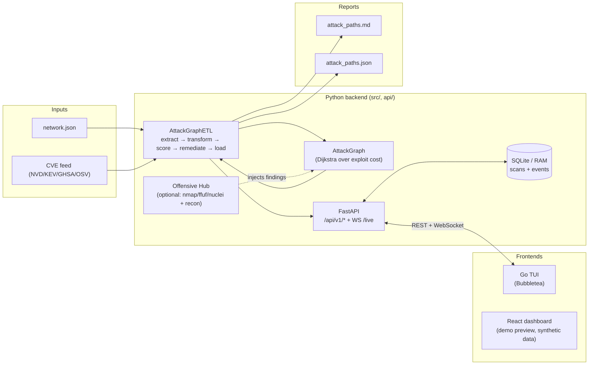

# ⚔️ Gordian 

[](https://www.python.org/downloads/)
[](https://opensource.org/licenses/MIT)
[](requirements.txt)

```text
         /\
        /  \
       |    |
       |    |
     __|____|__        ____               _ _             
    [==========]      / ___| ___  _ __ __| (_) __ _ _ __  
        |  |         | |  _ / _ \| '__/ _` | |/ _` | '_ \ 
     o--|--|--o      | |_| | (_) | | | (_| | | (_| | | | |
    / \ |  | / \      \____|\___/|_|  \__,_|_|\__,_|_| |_|
   o---o|--|o---o  
  / \ / |  | \ / \ 
 o---o  |  |  o---o    
  \ / \ |  | / \ / 
   o---o|--|o---o  
    \ / |  | \ /   
     o--|--|--o    
        |  |       
        \  /       
         \/

```
> A reasoning layer for vulnerability management that turns flat CVE lists into prioritized risk reduction.

Reads a network topology and an enriched CVE feed, builds a weighted attack graph, and finds the most probable multi-hop paths from an external attacker to your crown-jewel hosts. Then, it simulates patching to tell you **which CVE to patch first to break the most kill chains**.

*Note: Core ETL stays non-exploitative. Optional Offensive Integration Hub can orchestrate your installed Nmap/ffuf/Nuclei tools to enrich the graph in real time.*

## Security and authorized use

Use Gordian's offensive hub only on systems you own or have explicit written authorization to assess. Define the permitted targets, testing window and rate limits before running tools. Discovery of a host does not grant permission to scan it. You are responsible for complying with the engagement scope and applicable law. Findings, credentials and scan reports are sensitive; keep them out of public repositories. Risk scores are prioritization heuristics, not proof of exploitability or a security guarantee.

### Current operating boundary

- The API and Go TUI are the supported control plane. The React dashboard is an explicitly labelled **demo preview** with synthetic graphs and local-only controls.
- Set `GORDIAN_API_KEY` to the same randomly generated secret of at least 32 characters in the backend and TUI environments. Every API data/control route and event socket requires authentication. Keep the service on loopback; remote access requires a trusted TLS reverse proxy and restricted network access.
- Live API scans require a server-owned `--scope-file`. An empty allowlist denies all targets. Whole CIDRs, deny overlaps, discovered follow-up targets and resolved addresses are checked. Scanner redirects, DNS changes and tool-internal discovery still require OS/network egress isolation; scope checks are not a sandbox.
- API clients cannot select executables, arbitrary flags, command templates, interactive full-control mode, or unrestricted filesystem paths. Configure installed tools on the server. Core Python command overrides are trusted operator code with the privileges of the Gordian process.
- API datasets must be JSON files under `data/`; request wordlists must be under `data/wordlists/`. Per-scan reports go under `reports/<scan-id>/`. The API does not sync remote CVE feeds; use prepared local feeds, or sync with `--once --cve-profile` and point the server at the cached file.
- Raw command arguments and raw tool lines are withheld from public event/report serialization. Redaction is best effort for interpreted findings; treat every report as private evidence.

Generate a local key in PowerShell before starting the backend (then provide the same key to the TUI process without committing it):

```powershell
$env:GORDIAN_API_KEY = python -c "import secrets; print(secrets.token_urlsafe(32))"
python main.py --headless --offensive-disable
```

This starts the authenticated API with active tooling disabled. A REST request or the Go TUI starts analysis. For an authorized live engagement, configure `--scope-file` and omit `--offensive-disable`.

Development tests require `pip install -r requirements-dev.txt`. Runtime dependencies are pinned in `requirements.txt`; re-audit them before each release. Go builds require Go 1.26.9 or newer.

### Public release gate

Before each public release, complete all checks below and treat them as a hard gate:

- [ ] Security baseline files exist and are current: `LICENSE`, `SECURITY.md`, `.env.example`, `.gitleaks.toml`.
- [ ] Dependency audits pass (`pip_audit`, `npm audit`, `govulncheck`) in CI.
- [ ] Working tree secret scan passes:
  - `gitleaks dir . --config .gitleaks.toml --redact`
- [ ] Full Git history secret scan passes:
  - `gitleaks git . --config .gitleaks.toml --redact --log-opts=--all`
- [ ] Reports/data/manual review passes: no customer identifiers, environment-specific hosts/IPs, credentials, or private evidence is present in publishable files.

If any real credential is detected in current files or history, rotate it immediately, revoke old access, and rewrite history before publication. Deleting files alone is insufficient.

False positives must be handled through narrowly scoped rules in `.gitleaks.toml` with justification comments; do not suppress findings globally.

---

## 📑 Table of Contents

- [Why this exists](#-why-this-exists)
- [Key Features](#-key-features)
- [How it Works (The Pipeline)](#-how-it-works-the-pipeline)
- [Architecture](#-architecture)
- [Installation & Requirements](#-installation--requirements)
- [Usage](#-usage)
- [Example Output](#-example-output)
- [Sample Scenario](#-sample-scenario)
- [Project Layout](#-project-layout)
- [Future Roadmap](#-future-roadmap)
- [License](#-license)

---

## 💡 Why this exists

I kept reading about attack-path and attack-graph tooling and wanted to work through the underlying problem myself before reaching for a graph library or a commercial product. The algorithm is simple; the interesting parts are the edge-cost heuristic, the scoring, and answering the critical question: *"Which patch buys me the most risk reduction?"* So, I wrote those out.

## ✨ Key Features

- **Small core:** The graph engine (`src/transformers.py`, `src/scoring.py`, `src/remediation.py`) is plain Python with no graph library. The server adds FastAPI, uvicorn and rich (pinned in `requirements.txt`).
- **Dijkstra-based Pathfinding:** Finds the most probable/cheapest attack paths, not just the ones with the fewest hops.
- **Smart Scoring:** Blends CVSS, EPSS, weaponization status, and target criticality into a composite risk score (0-100).
- **Patch Simulation:** Identifies "chokepoint" vulnerabilities that, when patched, break multiple kill chains—often surfacing lower-CVSS bugs that are critical for lateral movement.
- **CI gate:** `python main.py --once --fail-on-findings` exits with code 3 if any kill chain exists.
- **Offensive Integration Hub (Optional):** Async orchestration of Nmap/ffuf/Nuclei plus optional recon adapters (Subfinder, Amass, BBOT, Katana, HTTPX, SecretFinder, LinkFinder, Gitleaks, Aquatone, Gowitness) with live output parsing, graph injection, and plain-language narratives.

## ⚙️ How it Works (The Pipeline)

Two JSON inputs go in:
1. **Network Topology:** Hosts, exposed services, and firewall/segmentation rules (which host/port can reach which).
2. **CVE Feed:** CVSS, EPSS, MITRE ATT&CK mapping, and whether the exploit is weaponized in the wild.

The internal process:
1. **Extract** — Async JSON load, processing both feeds in parallel.
2. **Transform** — Build a directed weighted graph. An edge `A -> B` exists only if `A` can reach `B` on a specific port, `B` has a service listening on that port, and that service exposes a CVE.
3. **Pathfind** — Run Dijkstra's algorithm over the exploit cost, from each attacker entry point to each crown jewel.
4. **Score** — Generate a 0-100 composite risk score per chain, applying hop penalties and factoring in target value.
5. **Remediate** — Simulate patching each CVE in a chain (hide its edges in a filtered view of the graph, re-run the pathfinder) and measure the aggregate risk reduction to rank patches.
6. **Load** — Write JSON and Markdown reports, and pretty-print a summary to the console (`--once` without `--quiet`).

The CPU-bound stages (graph build, pathfinding, patch simulation) run in worker threads, so the API keeps serving REST and WebSocket traffic while a scan is in progress.

Optional runtime extension:
7. **Offensive Integration Hub** (API scans only) — Build tool commands from server-owned config, run tools concurrently via `asyncio.create_subprocess_exec`, parse output line-by-line, inject new graph edges/nodes, and stream live events for dashboards.

## 🏛 Architecture



**Component map:**

| Layer | Path | Role |
|---|---|---|
| Core engine | [src/transformers.py](src/transformers.py), [src/scoring.py](src/scoring.py), [src/remediation.py](src/remediation.py) | Build graph, run Dijkstra, score chains, simulate patches |
| Pipeline | [src/orchestrator.py](src/orchestrator.py) | Async ETL wiring with progress + live-log hooks |
| CVE sourcing | [src/cve_sources.py](src/cve_sources.py), [src/cve_filtering.py](src/cve_filtering.py) | NVD / CISA KEV / GHSA / OSV fetch + asset-aware filtering |
| Offensive hub | [src/offensive/](src/offensive/) | Tool orchestration, scope policy, parsers, finding injection, storyteller |
| API | [api/app.py](api/app.py), [api/routes.py](api/routes.py), [api/state.py](api/state.py) | FastAPI server, scan lifecycle, WebSocket broadcast |
| Storage | [api/storage.py](api/storage.py) | SQLite (WAL) or in-memory backend for scan + event history |
| TUI | [tui/](tui/) | Bubbletea terminal UI: dashboard, map, config, live log |
| Reports | `reports/attack_paths.{md,json}` | Operator-facing output |

**Runtime entry points:**
- `python main.py` — starts the FastAPI server (default loopback bind on `127.0.0.1:8000`). Start the Go TUI separately with `go run ./cmd/gordian` from `tui/`.
- `python main.py --headless` — backend only, no boot animation.
- `python main.py --once` — one-shot analysis without the server; see [Usage](#-usage).
- `GORDIAN_API_KEY=…` — mandatory random secret of at least 32 characters; used for REST and event-socket authentication.
- `GORDIAN_CORS_ORIGINS=https://x,https://y` — override loopback-only CORS default.

## 🚀 Installation & Requirements

**Requirements:** Python 3.11+ (`pip install -r requirements.txt`). Go 1.26.9+ for the TUI.

Clone the repository and run the tests to ensure everything is working:

```bash
git clone https://github.com/oxyec/gordian.git
cd gordian

# Optional: Run tests using pytest
pip install -r requirements-dev.txt
python -m pytest -v
```

## 💻 Usage

`main.py` has two modes. `python main.py --help` lists every flag, grouped by mode.

### 1. One-shot analysis (`--once`)

Runs the core pipeline once on local JSON inputs, writes `attack_paths.json` and `attack_paths.md`, prints a summary and exits. It does not start a server, does not need `GORDIAN_API_KEY` and never runs offensive tools.

```bash
# Bundled sample data
python main.py --once

# Your own data
python main.py --once --network /path/to/network.json --cves /path/to/cves.json --out /path/to/reports

# Skip patch simulation, or change how many patches are ranked
python main.py --once --no-remediation
python main.py --once --top-patches 10

# Drop CVEs unrelated to the hosts/services in the topology
python main.py --once --asset-aware-cves --asset-cve-min-score 2 --asset-cve-keep-top 120

# Pipeline events as JSON lines on stderr
python main.py --once --quiet --live-log 2> events.jsonl
```

**CI gate.** `--fail-on-findings` makes any kill chain fail the job:

```bash
python main.py --once --quiet --fail-on-findings --network network.json --cves cves.json
```

| Exit code | Meaning |
|---|---|
| `0` | Analysis completed; no kill chains, or `--fail-on-findings` not set |
| `1` | Runtime error: unreadable/invalid input, CVE feed sync failure |
| `2` | Usage error: unknown or conflicting flags (argparse) |
| `3` | Kill chains found and `--fail-on-findings` set |

Exit code 3 is deliberately distinct from argparse's 2, so a typo in a CI flag cannot be mistaken for a finding.

**Remote CVE feeds.** Instead of `--cves`, `--once` can sync a feed profile into a local cache and analyse that:

```bash
python main.py --list-cve-profiles
python main.py --once --cve-profile cisa_kev
python main.py --once --cve-profile all_plus --cve-max-items 3000 --cve-osv-lookup-limit 120
python main.py --once --cve-profile all_plus --cve-source-priority ghsa_recent,cisa_kev,nvd_recent,osv_enriched
python main.py --once --cve-profile all_plus --cve-disable-sources ghsa_recent,osv_enriched
python main.py --once --cve-profile all_latest --cve-sync-policy if-stale --cve-stale-hours 12 --cve-sync-schedule daily
python main.py --once --cve-profile cisa_kev --no-cve-auto-download   # cache only, no network
```

- Profiles: `local` (default, uses `--cves`), `nvd_recent`, `cisa_kev`, `all_latest`, `ghsa_recent`, `all_plus`.
- `--cve-cache-dir` (default `data/cve_cache`), `--cve-max-items`, `--cve-sync-policy {always,if-stale,never}`, `--cve-sync-schedule {off,daily,weekly}`, `--cve-stale-hours`.
- Syncs use conditional requests (ETag/If-Modified-Since).
- Known limitation: `nvd_recent` points at NVD's legacy 1.1 JSON feed, which NVD has been retiring. Prefer `cisa_kev`/`ghsa_recent` until the NVD source moves to the 2.0 API.

One-shot flags (`--fail-on-findings`, `--quiet`, `--no-remediation`, `--top-patches`, `--live-log`, `--cve-*`, `--asset-*`) are rejected without `--once`. Offensive flags are rejected with it.

### 2. API server (default)

```bash
python main.py --headless --offensive-disable                       # analysis only
python main.py --headless --storage sqlite --db-path scans.db       # persistent scan history
python main.py --headless --max-concurrent-scans 2
python main.py --headless --scope-file data/scope_policy.json       # allow authorized live scans
```

The server needs `GORDIAN_API_KEY` (see [Current operating boundary](#current-operating-boundary)). Start scans from the Go TUI (`go run ./cmd/gordian` in `tui/`) or with `POST /api/v1/scan/start`. Interactive docs are at `http://127.0.0.1:8000/docs`.

Server flags:
- `--api-host` / `--api-port`: bind address (default `127.0.0.1:8000`).
- `--storage {ram,sqlite}`, `--db-path`, `--max-concurrent-scans`.
- `--network`, `--cves`: default datasets. Requests may only name other JSON files under `data/`.
- `--out`: report root. Each scan writes to `<out>/<scan-id>/`.
- `--headless` / `--no-intro` / `--intro-speed`: boot animation.
- `--list-wordlists`: ffuf wordlist profiles that scan requests may select.

### Offensive hub (server-owned)

These flags set server-side limits. API clients can narrow them but never exceed them:

- `--offensive-config` (default `data/offensive_config.json`), `--offensive-mode {auto,manual,dry-run,disabled}`, `--offensive-target`, `--offensive-speed`, `--offensive-intensity`.
- `--offensive-dry-run` and `--offensive-disable` force dry-run or disabled mode for every scan.
- `--scope-file`: allow/deny policy. Required for any live (non dry-run) scan.
- `--max-nmap-rate`, `--max-ffuf-threads`, `--max-nuclei-rate`, `--max-total-targets`, `--max-total-commands`, `--max-findings`, `--max-run-seconds`: caps. The server also enforces hard ceilings of 40 / 20 / 80 / 40 / 100 / 2000 / 900 respectively.

`data/offensive_config.json` holds the base config (`mode`, `target`, `speed`, `intensity`, `tools`, `ffuf_wordlist_profile`, `directory_injection`, `tool_dependencies`, rate caps, …). The API rejects a config that contains `tool_command_overrides` or `tool_extra_args`, and always uses the built-in command templates, `require_scope_match=true` and `full_control=false`. Executables are resolved on the server; clients cannot choose binaries, flags or paths. Setting `"bugbounty_mode": true` there makes every scan run in bug bounty mode (lower rates, passive recon, no nmap `vuln` scripts); clients can turn it on per scan but cannot turn a server-enabled mode off.

Supported tools: `nmap`, `ffuf`, `nuclei`, `subfinder`, `amass`, `bbot`, `katana`, `httpx`, `secretfinder`, `linkfinder`, `gitleaks`, `aquatone`, `gowitness`.

Wordlist recommendation behavior:
- The hub recommends a profile based on `target`, `speed`, `intensity` and technology hints from the graph.
- If no explicit profile is selected, the top recommendation is used.
- For API-like targets, parameter-focused lists are prioritized.
- In bug bounty mode, recommendations favor lower-noise profiles before aggressive lists.

Scope policy controls:
- `hard_stop_hosts` in the scope policy file always blocks matching hosts, even if broader allow rules match.
- Scope policy can enforce additional caps (`max_nmap_rate`, `max_ffuf_threads`, `max_nuclei_rate`) that clamp runtime values.
- Scope policy can also enforce orchestration budgets (`max_total_targets`, `max_total_commands`, `max_findings`, `max_run_seconds`, `max_followup_targets`).
- Scope policy may define UTC execution windows via `allowed_time_windows`.

Trend report output:
- Every run writes a `trend` block in `reports/attack_paths.json`.
- If a baseline exists from the previous run, Markdown includes a `Trend Report` section.
- Core metrics include `new_cves_count`, `closed_risk`, `increased_kill_chain_risk`, `new_kill_chains`, `resolved_kill_chains`, `risk_delta`, `risk_change_percent`, `offensive_findings_delta`, and `offensive_unique_targets_delta`.

## 📊 Example Output

```text
== killchain-etl :: attack path analysis ==

  graph: 8 hosts, 10 exploit edges
  kill chains found: 2

  #1 -> backup-01.acme.example  [risk 93.7/100, 4 hops, max CVSS 10.0]
     > external-attacker    -> web-01.acme.example:443      CVE-2021-41773  (INITIAL_ACCESS, T1190)
     > web-01.acme.example     -> dev-ws-01.acme.example:445   CVE-2021-34527  (PRIVILEGE_ESCALATION, T1068)
     > dev-ws-01.acme.example  -> dc-01.acme.example:445       CVE-2020-1472   (PRIVILEGE_ESCALATION, T1068)
     > dc-01.acme.example      -> backup-01.acme.example:873   CVE-2024-12084  (LATERAL_MOVEMENT, T1210)

  #2 -> db-prod-01.acme.example  [risk 84.4/100, 4 hops, max CVSS 10.0]
     > external-attacker    -> web-01.acme.example:443      CVE-2021-41773  (INITIAL_ACCESS, T1190)
     > web-01.acme.example     -> dev-ws-01.acme.example:445   CVE-2021-34527  (PRIVILEGE_ESCALATION, T1068)
     > dev-ws-01.acme.example  -> dc-01.acme.example:445       CVE-2020-1472   (PRIVILEGE_ESCALATION, T1068)
     > dc-01.acme.example      -> db-prod-01.acme.example:5432 CVE-2022-1552   (PRIVILEGE_ESCALATION, T1068)

  recommended patches (ranked by aggregate risk reduction):
     1. CVE-2020-1472   CVSS 10.0  breaks 2/2 chain(s), risk -178.1
     2. CVE-2021-41773  CVSS 9.8   breaks 2/2 chain(s), risk -178.1
     3. CVE-2024-12084  CVSS 9.8   breaks 1/2 chain(s), risk -93.7
     4. CVE-2022-1552   CVSS 8.8   breaks 1/2 chain(s), risk -84.4
```

*Insight:* The first two recommendations are chokepoints—patching either one breaks *both* kill chains. Interestingly, PrintNightmare (CVE-2021-34527) is dropped from the recommendations because patching it doesn't reduce overall risk (the attacker can simply reroute through the file server using a different CVE). A pure "sort by CVSS" prioritization would miss this insight.

### 🔴 Live Run with Offensive Integration

When an API scan request includes a target and the Offensive Hub kicks in, the TUI live-event
stream shows the recon→exploit feeding loop in real time. Each `CHAIN` line
is a `pipeline.tool_chain.spawned` event — a tool spawning another tool
against a target it just discovered:

```text
  12:01:03 ▸ CHAIN   scan         ──▶ subfinder  (acme.example)
  12:01:07 [·] offensive.finding   subfinder   Found 12 subdomains
  12:01:07 ▸ CHAIN   subfinder    ──▶ httpx     (api.acme.example)
  12:01:07 ▸ CHAIN   subfinder    ──▶ httpx     (admin.acme.example)
  12:01:09 [·] offensive.finding   httpx       nginx/1.22 on api.acme.example:443
  12:01:09 ▸ CHAIN   httpx        ──▶ nuclei    (https://api.acme.example)
  12:01:09 ▸ CHAIN   httpx        ──▶ katana    (https://api.acme.example)
  12:01:14 [!] offensive.finding   nuclei      critical: CVE-2024-XXXX on api.acme.example
  12:01:14 [·] pipeline.transform  hub         graph now: 11 hosts, 19 edges
  12:01:14 [·] pipeline.offensive  hub         offensive added 2 new kill chain(s)
```

And the Threat Overview panel updates live — no polling delay:

```text
  ─── OFFENSIVE ──────────────────
    chains:  2 → 4    Δ: +2 new
    +hosts: 3   +edges: 9
    tools:   ▶ nuclei,katana

  ─── FINDINGS ──────────────────
    nuclei    Nuclei identified a critical severity weakness (CVE-2024-XXXX)…
    httpx     A nginx web service is live on https:443, narrowing exploit templates.
    subfinder A previously unknown asset (api.acme.example) was uncovered via subfinder…
```

Every step in that chain is real: `subfinder` finds a subdomain → injected
into the attack graph → `httpx` is automatically spawned against the new
host → its tech-fingerprint result narrows down `nuclei` templates → a
discovered CVE becomes a new edge → Dijkstra reruns → the patch
recommendations update. You watch the system feed itself.

## 🗺️ Sample Scenario

The bundled network data represents a four-tier enterprise:

```text
INTERNET -> DMZ (web-01) -> CORP (fileserver, workstations) -> INFRA (dc-01) -> CROWN (db-prod-01, backup-01)
```

Segmentation is modeled at the `(host, port)` level. The attack path surfaced is the "bad Monday morning" scenario: an Apache path-traversal RCE on the edge -> PrintNightmare onto a dev workstation -> Zerologon into the Domain Controller -> pivoting onto both crown jewels.

## 📁 Project Layout

```text
Gordian/
├── main.py                    # Entry point: API server or --once analysis
├── data/                      # Fixtures
│   ├── sample_network.json    # Bundled topology fixture
│   ├── cve_feed.json          # CVE enrichment fixture (CVSS + EPSS + MITRE)
│   └── offensive_config.json  # Offensive Integration Hub runtime config
├── src/
│   ├── models.py              # Data structures (Host, Service, AttackPath, ...)
│   ├── extractors.py          # Async JSON loaders
│   ├── transformers.py        # Graph builder + Dijkstra logic
│   ├── scoring.py             # Edge cost heuristics + composite risk score
│   ├── remediation.py         # Patch-priority simulator
│   ├── loaders.py             # JSON / Markdown / Console output sinks
│   ├── orchestrator.py        # Pipeline wiring
│   └── offensive/             # Offensive hub modules (config, runner, parsers, injector, storyteller)
├── tests/                     # Test suite
│   ├── test_pathfinder.py     # Graph + pathfinder regressions
│   ├── test_orchestrator.py   # End-to-end + malformed-input tests
│   └── test_offensive_*.py    # Offensive hub tests
└── reports/                   # Generated reports land here
```

## 🔮 Future Roadmap

What's *not* here (yet):
- **Credential Graph:** BloodHound-style Kerberos delegation/ACL paths are a separate modeling problem.

Ideas for the future:
- **Credential-reuse Edges:** Compromising a workstation yields credentials that work elsewhere.
- **Scanner Adapters:** Nmap XML is the obvious first target.
- **Neo4j Export:** Persist the graph to Neo4j for interactive querying.
- **Parallel Remediation:** Parallelize the patch simulator across CVEs (it's embarrassingly parallel).

## 📄 License

This project is licensed under the MIT License.
